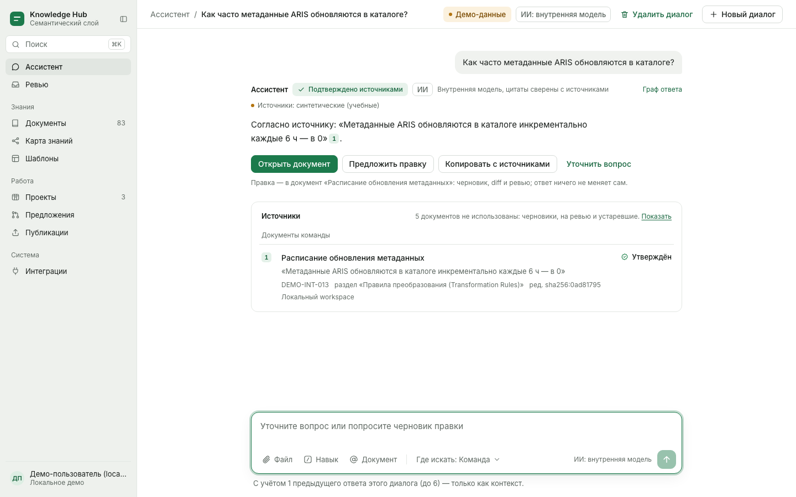
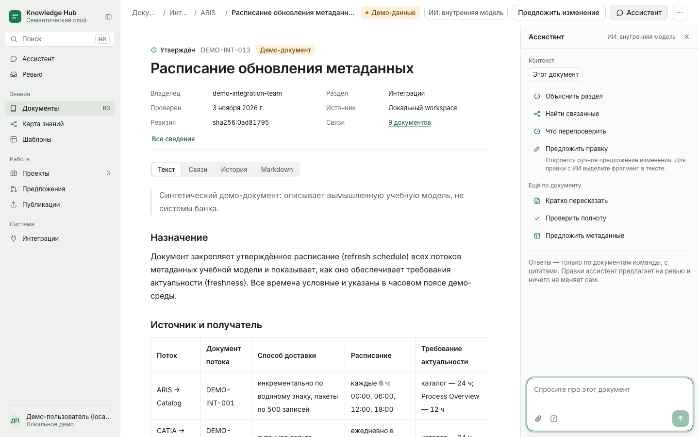
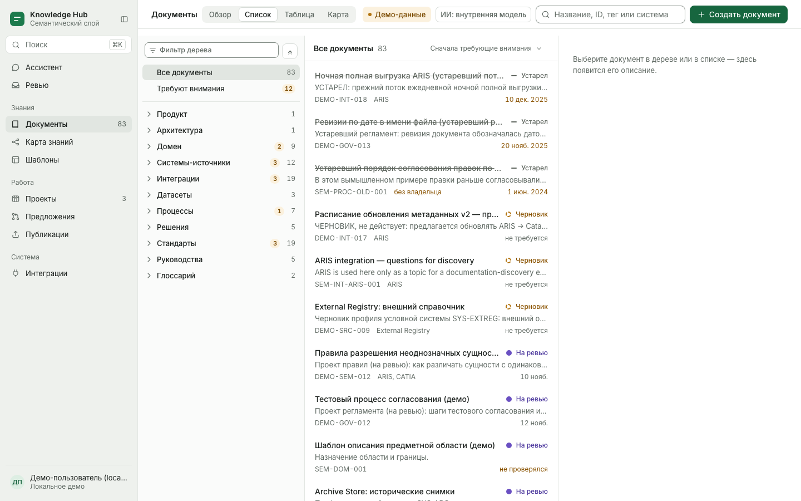
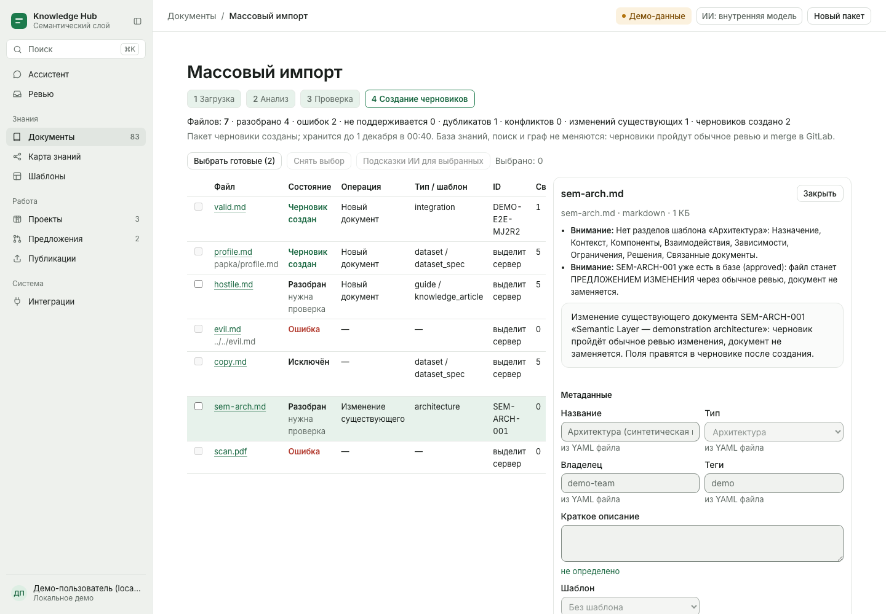
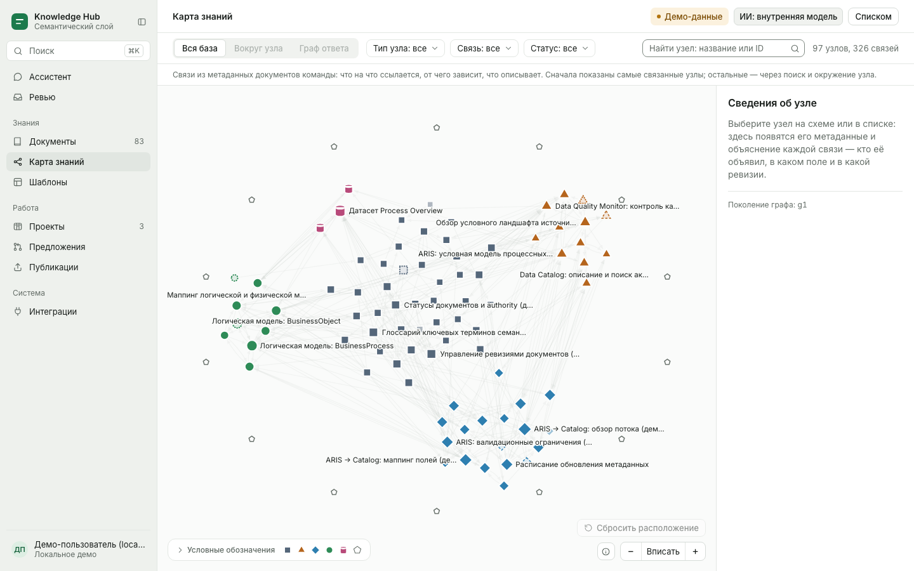
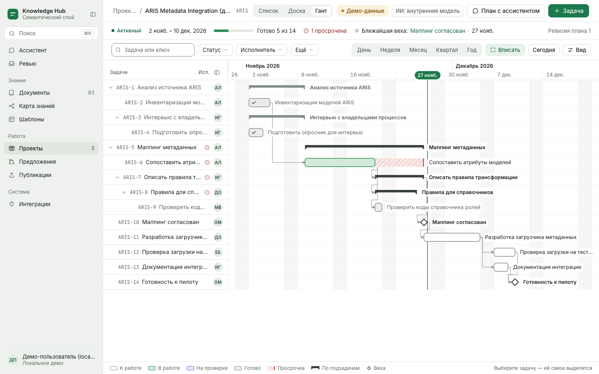
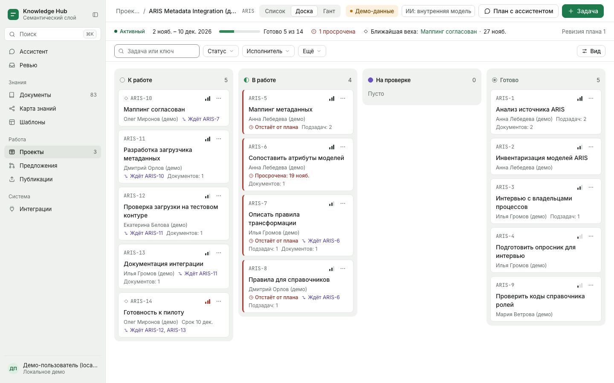
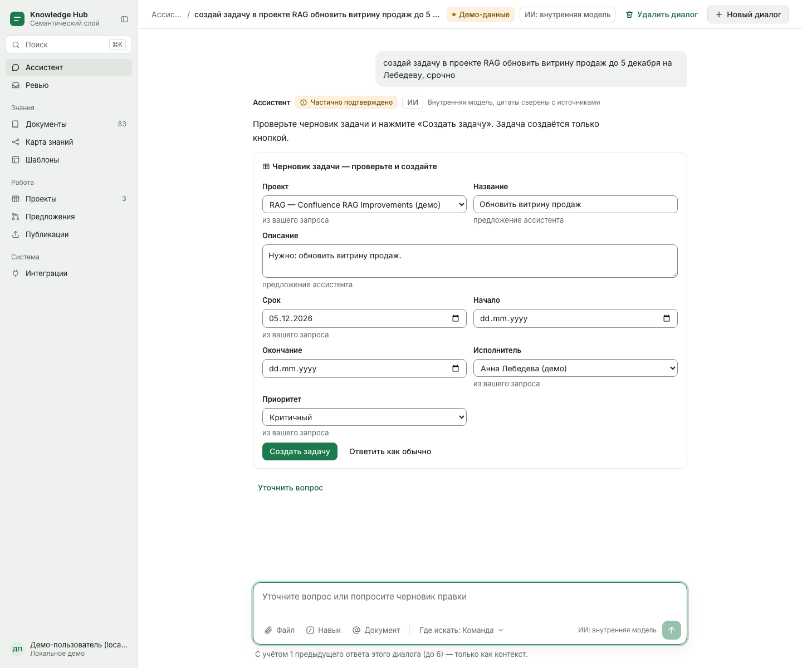

# Semantic Knowledge Hub

**База знаний с AI-ассистентом для команды семантического слоя банка.**

> **Прототип продукта (ноябрь 2026).** Этот репозиторий — прототип, собранный и проверенный на синтетических данных.
> По его итогам решение было интегрировано в контуры банка: каноническая база знаний хранится во внутреннем GitLab,
> корпоративные знания читаются из Confluence Data Center, ответы готовит внутренняя языковая модель. Банковские
> данные, доступы и конфигурация контура в этот репозиторий не входят.



## Зачем

Знания команды семантического слоя — определения, модели данных, интеграции, архитектурные решения — разбросаны по
Confluence, файлам и переписке. Чтобы ответить на простой вопрос («как часто обновляются метаданные ARIS?»), приходится
искать в нескольких системах, и нет уверенности, что найденный документ актуален и утверждён.

Semantic Knowledge Hub собирает утверждённые документы команды в одну базу со связями между ними и даёт ассистента,
который:

- **отвечает только по документам команды** и показывает дословные цитаты, сверенные сервером; если опоры нет, честно
  говорит, что данных недостаточно;
- **различает статусы**: утверждённое, черновики, документы на ревью и устаревшее;
- **готовит черновики и правки, но ничего не меняет сам**: каждое изменение проходит предпросмотр, ревью и решение
  человека;
- **связывает знания с работой команды**: проекты, задачи и сроки живут рядом с документами, на которые опираются.

## Что умеет

### Ассистент с проверяемыми ответами

Ответ собирается из выдержек документов команды; каждая цитата проверяется сервером, рядом — статус и ревизия
источника. При нехватке своих документов ассистент сам решает, искать ли в Confluence, и называет найденное внешним
источником. Ему доступны инструменты системы — каталог, поиск, граф, шаблоны: на вопрос «сколько документов требуют
внимания?» он отвечает по данным реестра, а не по догадке.

### Документы, шаблоны и ревью



Документы — Markdown с метаданными: владелец, статус, версия, типизированные связи. Новые документы создаются по
версионируемым шаблонам или с чистого листа; изменения идут через предложение → diff → ревью → утверждение, при
подключении GitLab — через merge request. Утверждённые документы можно опубликовать в Confluence.



### Массовый импорт



Команда переносит накопленные материалы пакетом: ZIP-архив, папку или набор файлов (Markdown, текст, PDF, DOCX).
Система разбирает каждый файл, предлагает метаданные с опорой на текст, находит копии, конфликты и связи с
документами базы; файл с номером существующего документа становится предложением изменения, а не новым
документом. Подсказки языковой модели проверяются по тексту файла и применяются только человеком. Человек
отмечает нужные файлы и сам создаёт черновики — в базу знаний они попадают обычным путём, через ревью.

### Карта знаний



Связи между документами объявляют люди в метаданных — «зависит от», «описывает», «использует». Карта показывает их
вместе с происхождением: кто объявил связь, в каком поле и в какой ревизии.

### «Работа»: проекты, задачи, Гант



Собственный лёгкий трекер внутри базы знаний: проекты, задачи и подзадачи, список, доска и Гант над одними данными,
зависимости «окончание → начало», рабочий календарь, история изменений. Задача ссылается на документы, и при каждом
открытии видно, не изменился ли документ после того, как на него сослались.



### Задача прямо из чата



Фраза «создай задачу в проекте RAG обновить витрину продаж до 5 декабря на Лебедеву, срочно» превращается в карточку:
поля заполнены из слов человека и помечены, откуда взяты, а задачу создаёт кнопка. Даты ассистент никогда не
придумывает — только берёт из сказанного. Тем же правилом ассистент разбирает проект, составляет план задач по
документам и предлагает изменения существующих задач; всё это — предложения, которые подтверждает человек.

## Принципы

- **Источник правды — утверждённые документы.** Рабочая база хранится в GitLab команды; Confluence — корпоративный
  источник и витрина опубликованного; в GitHub — только код прототипа.
- **ИИ предлагает — человек решает.** Ни один ответ, черновик или план не применяется без явного действия человека;
  слова в чате («да», «применяй») ничего не меняют.
- **Каждый ответ с происхождением.** Источник, ревизия и фрагмент указаны у каждой цитаты; ссылка, которую сервер не
  смог подтвердить, не показывается как факт.
- **Модель заменяемая.** Приложение работает без модели (детерминированный режим), с внутренней моделью банка через
  OpenAI-совместимый API; агентная среда разработки — GigaCode. Логика приложения не привязана к поставщику.
- **Данные банка не покидают контур.** Прототип и его тесты используют только синтетические данные; интеграции включаются
  конфигурацией и по умолчанию работают только на чтение.

## Как развивался прототип

| Этап | Результат |
|---|---|
| База знаний и ассистент | 83 синтетических документа, поиск, шаблоны, ассистент с проверенными цитатами, ревью и публикация на тестовых двойниках GitLab и Confluence |
| Качество ответов | 216 эталонных вопросов для объективной оценки; 210 проходят, шесть оставшихся провалов разобраны |
| Интерфейс | Новый интерфейс: ассистент, документы, карта знаний, шаблоны |
| Ассистент знает систему | Ассистент пользуется инструментами каталога, поиска и графа |
| «Работа» | Проекты, задачи, Гант, доска, связь задач с документами, план задач от ассистента |
| Адаптивный поиск | Решение «искать ли во внешних источниках» одним коротким вызовом модели — под слабую внутреннюю модель |
| Задачи из чата | Анализ проекта, план и изменения задач, «Создать задачу» |
| Массовый импорт | ZIP, папка или файлы → разбор, проверка человеком, черновики через обычное ревью |

Подробнее с цифрами — [reports/README.md](reports/README.md). Архитектурные решения — [docs/DECISIONS.md](docs/DECISIONS.md).

## Путь в контур банка

Прототип изначально строился под перенос в банковский контур:

- **Адаптеры вместо жёстких зависимостей.** Хранилище знаний (локально → GitLab), корпоративные знания
  (Confluence через MCP), публикация (Confluence REST) и языковая модель (без модели → внутренний API) переключаются
  конфигурацией, без переписывания кода.
- **Режимы подключения по шагам:** офлайн → тестовые двойники → тестовые системы только на чтение → запись в тестовое
  пространство по отдельному разрешению. Перед подключением — офлайн-проверка конфигурации и проверка доступности
  только запросами чтения.
- **Требования к контуру** подготовлены заранее: что нужно от инфраструктуры и ИБ, требования к единому входу и ролям,
  перечень ограничений прототипа.

Документы: [интеграции](docs/INTEGRATIONS.md), [готовность к подключению](docs/M4_M5_INTEGRATION_READINESS.md),
[SSO и роли](docs/SSO_RBAC_REQUIREMENTS.md), [ограничения прототипа](docs/PRODUCTION_BLOCKERS.md),
[GigaCode](docs/GIGACODE_MIGRATION.md).

## Для команды

```bash
make up        # демо офлайн на синтетических данных → http://127.0.0.1:5173
make check     # линтеры, типы, unit- и интеграционные тесты backend и frontend
```

- Запуск, тестовые двойники, тесты, конфигурация, структура кода — [docs/DEVELOPMENT.md](docs/DEVELOPMENT.md).
- Оглавление документации — [docs/README.md](docs/README.md).
- Правила для агентов разработки (Claude Code, GigaCode) — [CLAUDE.md](CLAUDE.md), [AGENTS.md](AGENTS.md).

Технологии: Python 3.12 + FastAPI, React + TypeScript + Vite, SQLite FTS5, Docker Compose. Векторной БД, эмбеддингов и
внешних AI-сервисов по умолчанию нет.
