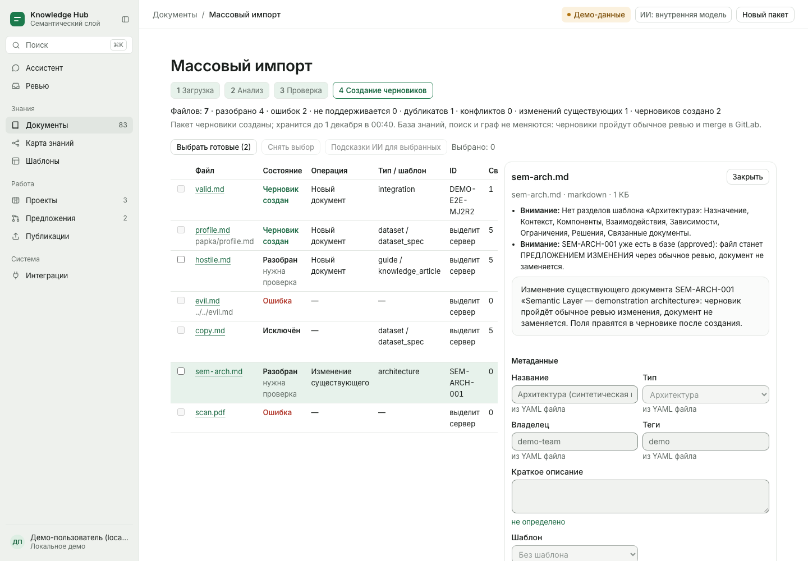

# Массовый импорт знаний (M8 AI Knowledge Onboarding)

«Массовый импорт» загружает сразу много документов: ZIP-архив, папку или набор файлов. Система разбирает каждый
файл, предлагает метаданные, находит дубликаты, конфликты и кандидатов связей. Человек проверяет и правит
предложения и **явно** создаёт черновики. Дальше черновики идут по обычному пути: ревью → merge в GitLab →
синхронизация индекса.

Главное правило: **импорт ничего не добавляет в базу знаний сам**. Пакет и его анализ лежат во временном
хранилище (staging). Каталог, поиск FTS5, граф и ответы ассистента меняются только после ревью и merge — через
тот же механизм поколений индекса, что и для любого черновика.



## 1. Руководство пользователя

Где найти: «Документы» → «Создать документ» или «Импорт» → ссылка «массовый импорт». Прямой адрес —
`/documents/onboarding`.

1. **Загрузка.** «Выбрать файлы или ZIP», «Выбрать папку» или перетащите файлы на страницу. Принимаются `.md`,
   `.markdown`, `.txt`, `.pdf`, `.docx` и `.zip`. Лимиты по умолчанию: до 200 файлов, 20 МБ загрузки, 100 МБ
   после распаковки, 10 МБ на файл. Пакет хранится 72 часа. Его можно открыть снова из списка «Недавние пакеты»
   или по ссылке `?batch=…`.
2. **Анализ.** В таблице для каждого файла видны: состояние, операция («Новый документ» или «Изменение
   существующего»), тип и шаблон, ID, число кандидатов связей и замечания. Над таблицей — счётчики пакета.
   Плохие файлы (небезопасный путь, вложенный архив, битый PDF, двоичные данные) помечены «Ошибка» или «Не
   поддерживается» и выбрать их нельзя. Точные копии помечены «Исключён». **Ничего не выбрано заранее.**
3. **Проверка файла.** Клик по имени открывает панель файла:
   - диагностика: ошибки YAML, отсутствующие разделы шаблона, совпадения с существующими документами;
   - поля (название, тип, владелец, теги, описание, шаблон). У каждого поля указан источник («из YAML файла»,
     «из текста», «по правилам», «изменено вами») и цитата-опора;
   - «Подсказки ИИ» — только если подключена языковая модель. Каждую подсказку принимают кнопкой «Принять»,
     сами они не применяются;
   - кандидаты связей (WikiLinks, `related_ids`, упоминания ID). Связи из YAML отмечены, предложения — нет;
   - предпросмотр текста, а для изменения существующего документа — diff.

   «Сохранить решения» записывает правки и отмечает файл проверенным. «Исключить из импорта» убирает файл из
   выбора.
4. **Подтверждение.** Отметьте нужные файлы («Выбрать готовые» отмечает все допустимые) → «Проверить выбор»
   покажет план без побочных эффектов → «Создать черновики». Двойной клик, повтор запроса и перезагрузка
   страницы не создают второй черновик.
5. **Дальше — обычный путь.** Ссылки «черновик …» ведут в «Предложения»: там черновик правят, отправляют на
   ревью, а после merge и синхронизации документ появляется в базе, поиске и графе.

«Отменить пакет» (с подтверждением) удаляет содержимое файлов из staging. Уже созданные черновики остаются.

## 2. Жизненный цикл и инварианты

```
загрузка → staging (batch) → анализ → решения человека → «Проверить выбор» (план, отпечаток)
        → «Создать черновики» (явно, идемпотентно) → черновики M4.6 → ревью → merge в GitLab → sync → база знаний
```

- **Нет второго жизненного цикла.** Черновики создаются существующими методами `ProposalService`:
  `create_imported` для файла с корректным YAML без правок, `create_new_document` для файла без YAML или с
  правками, `create` (операция `update`, с `base_revision`) для изменения существующего документа. `origin` у
  всех трёх — `import`, причина — «Массовый импорт {пакет}: файл «{путь}»».
- **Существующий ID — всегда UPDATE.** Файл с ID одобренного документа становится предложением изменения через
  обычное ревью, а не новым документом (OB-09). Если YAML файла непригоден, но в нём указан существующий ID,
  панель предупреждает: будет создан НОВЫЙ документ, а чтобы предложить изменение, нужно исправить YAML.
- **Статус не повышается.** Черновик всегда `draft`. Ни импорт, ни модель не делают документ `approved`, не
  отправляют на ревью и не публикуют.
- **Индекс не трогается до merge.** `BatchOut.index_unchanged = true`. Тесты сверяют число документов, поколение
  индекса, рёбра графа и вызовы GitLab до и после.
- **Пакет принадлежит одному человеку.** Чужой пакет отвечает `404` (существование не раскрывается). Для
  загрузки нужно право `create_proposal`, роль «читатель» получает `403`. Существующие документы видны только
  из снимка этого читателя.

## 3. Архитектура

| Модуль | Назначение |
|---|---|
| `backend/app/services/onboarding/ingest.py` | Безопасный приём ZIP, папки и файлов в памяти (`io.BytesIO`, на диск ничего не пишется), лимиты, нормализация путей |
| `.../parsing.py` | Разбор: Markdown и текст (UTF-8, UTF-16 с BOM, cp1251 с предупреждением), PDF и DOCX через существующий `attachments.extract` |
| `.../analysis.py` | Анализ файла через существующий `MetadataService.import_preview`, затем по пакету: дубликаты, конфликты, UPDATE, кандидаты связей |
| `.../store.py` | `OnboardingStore` — три таблицы в app-state SQLite: `onboarding_batches`, `onboarding_items`, `onboarding_confirmations` |
| `.../service.py` | `OnboardingService`: пакеты, решения (compare-and-set по `revision`), план, подтверждение, отмена, TTL |
| `.../suggest.py` | `OnboardingSuggester`: ограниченные подсказки модели с серверной проверкой |
| `backend/app/adapters/ai/onboarding_protocol.py` | Независимый от поставщика протокол модели: строгий JSON, дословные цитаты |
| `backend/app/api/onboarding.py` | HTTP API `/api/onboarding/*` |
| `frontend/src/pages/KnowledgeOnboardingPage.tsx`, `frontend/src/components/onboarding/ItemInspector.tsx` | Экран «Массовый импорт» |

**Состояния пакета:** `uploaded → parsed → review → confirmed | partially_confirmed | rejected | expired`.
**Состояние файла:** `parse_status` (`parsed`, `invalid`, `unsupported`, `duplicate`, `conflict`) и вычисляемый
`status` (`reviewed`, `skipped`, `draft_created`, `draft_failed`).

**Подтверждение.** `preview` возвращает `fingerprint` — хеш ревизии пакета, ревизий выбранных файлов и ревизий
целевых документов. `confirm` принимает `expected_revision`, `fingerprint`, `item_ids` и `idempotency_key`.
Устаревшая ревизия или изменившийся документ дают `409 stale_revision` / `409 fingerprint_mismatch`. Повтор с тем
же ключом возвращает сохранённый результат, тот же ключ с другим выбором — `409`. Каждый файл получает
стабильный `client_request_id = onb-<пакет>-<файл>`, поэтому и новый ключ не создаст второй черновик для уже
подтверждённого файла. Результат по каждому файлу хранится (`draft_created` / `draft_failed` с кодом).
Подтверждения одного пакета сериализуются блокировкой `asyncio` (процесс один).

## 4. Безопасность и лимиты

| Угроза | Защита |
|---|---|
| Path traversal, абсолютные пути, буквы дисков, `%2e%2e`, управляющие символы | `safe_path`: файл отклоняется (`unsafe_path`), остальной пакет обрабатывается |
| Символические ссылки и спецфайлы в ZIP | Отклоняются (`special_file`) |
| ZIP-бомба | Лимиты на число файлов (`too_many_files`, 413), суммарный размер (объявленный и фактический, `archive_too_large`), степень сжатия записи (`archive_ratio_exceeded`) |
| Вложенные и зашифрованные архивы | Вложенный не распаковывается (`nested_archive`), зашифрованный отклоняется (`archive_encrypted`, 422) |
| Совпадение имён по регистру и похожим символам | NFKC + casefold, второй файл — `path_collision` |
| Двоичные данные под видом текста, исполняемые файлы | `binary_content` / `executable_content`, файл `invalid` |
| Инъекция промпта в тексте файла | Текст — данные: он не исполняется и не пересылается дальше. У модели нет инструментов. Ответ разбирается строго, лишние ключи (`status`, `publish`, `actions`) игнорируются (OB-11) |
| XSS в предпросмотре | Тот же санитайзер Markdown, что и у одиночного импорта (`SafeHtml`) |
| Доступ | Право `create_proposal`, пакет привязан к автору, чужое — `404` |

Параметры (переменные окружения, значения по умолчанию):

| Переменная | По умолчанию | Смысл |
|---|---|---|
| `ONBOARDING_UPLOAD_MB` | 20 | Размер загрузки |
| `ONBOARDING_EXPANDED_MB` | 100 | Все файлы после распаковки |
| `ONBOARDING_MAX_FILES` | 200 | Файлов в пакете |
| `ONBOARDING_FILE_MB` | 10 | Один файл |
| `ONBOARDING_MAX_RATIO` | 50 | Степень сжатия одной записи ZIP (для записей больше 1 МБ) |
| `ONBOARDING_TTL_HOURS` | 72 | Сколько хранится пакет; потом содержимое удаляется, пакет — `expired` (`410 staging_expired`) |
| `ONBOARDING_AI_ITEMS` | 20 | Сколько файлов пакета модель может разобрать (0 — ни одного) |

## 5. Подсказки модели

- Без модели (`AI_PROVIDER=mock` или `disabled`) импорт полностью работает на детерминированном анализе. На
  экране написано «Языковая модель не подключена», `POST …/suggest` возвращает `unavailable`.
- С моделью (`internal_api`, `claude_cli`) — один короткий запрос на файл, до 10 файлов за вызов, не больше
  `ONBOARDING_AI_ITEMS` на пакет. Текст файла обрезается до 6000 символов, разметка экранируется, известные фразы
  инъекций вырезаются.
- Сервер проверяет каждое значение. Название, описание и владелец остаются только с **дословной** цитатой из
  файла. Тип берётся только из `DocType`, шаблон — только из активных шаблонов. Теги — только из словаря базы или
  слов файла. Остальное отбрасывается, счётчик отброшенного виден.
- Подсказка хранится с `origin: model` и уверенностью модели и **не применяется сама**. Принятая кнопкой
  «Принять» и сохранённая подсказка становится решением человека (`origin: user`).
- Ошибка или неформатный ответ модели помечаются явно («Модель не ответила…»), детерминированные подсказки
  остаются (OB-10).

## 6. Связи и интерфейс к M9/M10

M8 не пишет фактов в граф. Кандидаты связей — это `CandidateLink` с `status: "candidate"` и
`bound_to_entity_graph: false`:

- виды: `wikilink`, `related_id`, `mention`, `similar`;
- состояние цели: `resolved` (документ в базе читателя), `in_batch` (файл этого пакета), `missing`,
  `ambiguous`;
- у каждого кандидата есть цитата-опора (файл, строка, фрагмент).

Отмеченные человеком кандидаты попадают в `related_ids` черновика, то есть становятся обычными ссылками. Они
войдут в граф после ревью, merge и синхронизации. Типизированные отношения по-прежнему объявляют люди в YAML.

Задел для M9/M10 (`SKH_M8…/07_INTEGRATION_WITH_M9_M10.md`):
- `Evidence(file, line, snippet, document_id)` соответствует будущему `EvidenceReference(document_id, revision,
  span, hash, excerpt)`: файл адресуется `item_id` + `checksum_sha256`, документ — `existing_doc.revision`;
- `CandidateLink` соответствует будущему `RelationCandidate`, тип связи пока `references`.

Когда появится сервис кандидатов M9, отмеченные кандидаты нужно будет передавать туда. Пока его нет, флаг
`bound_to_entity_graph: false` явно говорит, что в каноническом графе их нет.

## 7. API (кратко)

Все маршруты требуют право `create_proposal` и заголовок `X-SKH-Client` на изменяющих запросах. Подробности и
коды ошибок — [API_CONTRACTS.md](API_CONTRACTS.md), раздел v0.11.

| Метод и путь | Что делает |
|---|---|
| `GET /api/onboarding/capabilities` | Форматы, доступность парсеров, лимиты, доступность модели |
| `POST /api/onboarding/batches` | multipart: части `files` (имя = относительный путь) + `source_kind` (`zip`, `folder`, `files`) → `201 BatchOut` |
| `GET /api/onboarding/batches` | Мои пакеты |
| `GET /api/onboarding/batches/{batch_id}` | Пакет: счётчики, файлы |
| `GET/PATCH /api/onboarding/batches/{batch_id}/items/{item_id}` | Файл: поля, опоры, кандидаты, предпросмотр; решения с `expected_revision` |
| `POST /api/onboarding/batches/{batch_id}/suggest` | Подсказки модели для ≤ 10 файлов |
| `POST /api/onboarding/batches/{batch_id}/preview` | План без побочных эффектов + `fingerprint` |
| `POST /api/onboarding/batches/{batch_id}/confirm` | Создать черновики (идемпотентно) |
| `POST /api/onboarding/batches/{batch_id}/cancel` | Отменить пакет, удалить содержимое |

## 8. Проверка (матрица приёмки OB-01…OB-22)

Тесты: `backend/tests/test_onboarding.py`, `test_onboarding_protocol.py`, `test_onboarding_gitlab.py`
(жизненный цикл на тестовом дубле GitLab), `frontend/src/__tests__/onboarding.test.tsx`, Playwright
`frontend/e2e/onboarding.spec.ts` (сценарный двойник модели, `E2E_SCRIPTED_URL`).

| ID | Что проверено | Где |
|---|---|---|
| OB-01, OB-12 | 5 файлов разобраны, база/индекс/граф/GitLab не изменились; отмена пакета | `test_ob01_ob12_…` |
| OB-02 | Загрузка папки в браузере сохраняет относительные пути | E2E «a folder upload keeps the relative paths» |
| OB-03 | Пустой, битый, зашифрованный ZIP → безопасный 4xx, пакета нет | `test_ob03_…`, E2E «a corrupt archive is refused» |
| OB-04 | `../../evil.md`, абсолютный путь, буква диска, `%2e%2e`, symlink отклонены, вне staging ничего не записано | `test_ob04_…`, E2E |
| OB-05 | Число файлов, ZIP-бомба, степень сжатия, вложенный архив | `test_ob05_…` |
| OB-06 | Markdown без YAML: метаданные с опорой и правка человеком | `test_ob06_…`, E2E |
| OB-07 | Битый YAML: диагностика по файлу и путь исправления; предупреждение о неиспользованном ID | `test_ob07_…` (2) |
| OB-08 | Одинаковые ID и точные копии видны, второго черновика нет | `test_ob08_…`, E2E |
| OB-09 | ID одобренного документа → только UPDATE | `test_ob09_…`, E2E |
| OB-10 | Без модели и с падающей моделью импорт работает, отказ модели явный | `test_ob10_…` (2) |
| OB-11 | Инъекция в файле не вызывает действий, лишние ключи ответа игнорируются | `test_ob11_…`, `test_onboarding_protocol.py`, E2E (hostile.md) |
| OB-13, OB-14 | Подтверждение части, перезагрузка, повтор, двойной клик, новый ключ → те же черновики | `test_ob13_ob14_…`, `test_ob14_…`, vitest, E2E |
| OB-15 | Устаревшая ревизия, изменившийся документ, тот же ключ с другим выбором → 409 | `test_ob15_…` (2) |
| OB-16 | Чужой пакет — 404; читатель не может загрузить | `test_ob16_…` |
| OB-17 | Черновик → ревью → merge (дубль GitLab) → sync: документ появляется в поиске и графе только после merge | `test_onboarding_gitlab.py` |
| OB-18 | Пакет переживает перезапуск сервиса | `test_ob18_…` |
| OB-19 | Длинные кириллические имена, Unicode, похожие имена | `test_ob19_…` |
| OB-20 | PDF без парсера — «не поддерживается», а не «разобран» | `test_ob20_…`, E2E (scan.pdf) |
| OB-21 | 100 файлов разбираются за ограниченное время | `test_ob21_…` |
| OB-22 | Связи — только кандидаты, рёбер графа нет | `test_ob22_…` |

Все проверки выполнены на синтетических данных. Подсказки модели проверены на сценарном двойнике
(`backend/tests/support/scripted_model.py`). Это проверка протокола и серверной проверки, а не качества реальной
модели (`TARGET_MODEL_NOT_VALIDATED`).

## 9. Ограничения

- Реальная языковая модель на подсказках M8 не проверялась. Реальные GitLab и Confluence не проверялись.
- Staging хранится в app-state SQLite. Подтверждения сериализуются блокировкой внутри процесса, поэтому
  предполагается один процесс backend, как у остальных модулей прототипа.
- PDF и DOCX: извлекается только текст, всегда с предупреждением «проверьте текст»; таблицы и картинки теряются.
  Сканы без текстового слоя дают ошибку.
- В пакете нет кодировок, кроме UTF-8, UTF-16 с BOM и cp1251.
- Для изменения существующего документа поля метаданных в импорте не правятся: правки делаются в самом черновике
  после создания (`update_fields_locked`).
- Если YAML непригоден, исходный frontmatter не сохраняется: черновик собирается из полей формы (об этом
  предупреждение `yaml_repair`).
- Кандидаты связей не типизируются (M10), сервиса кандидатов M9 ещё нет.
